# AI Tuition Assistant

SE4458 Midterm 1, Group 1. A conversational assistant that answers students' questions about tuition deadlines, installment rules, balances and payments. It decides by itself (through LLM function calling) whether to search the university's tuition policy document, call the tuition REST API, or do both.

The system has four parts:

| Component | Technology | Folder |
|---|---|---|
| **AI Agent** (CLI chat) | Python 3.12, OpenAI function calling, MCP client, httpx | [`agent/`](agent/) |
| **MCP Server**: `search_tuition_policies(query)` | Python 3.12, official MCP Python SDK, Streamable HTTP, BM25 index | [`mcp-server/`](mcp-server/) |
| **Tuition REST API** | Java 21, Spring Boot 4.1, Spring Security (JWT), Flyway, PostgreSQL | [`tuition-api/`](tuition-api/) |
| **API Gateway** | Kong 3.9 (DB-less, declarative config) | [`gateway/`](gateway/) |

**Demo video:** [Watch the demo video](https://drive.google.com/file/d/1Dib4eTC9KcRN86G32MoakmoktNgBZzFQ/view?usp=share_link)

## Contents

1. [Architecture](#1-architecture)
2. [Live deployment (Azure)](#2-live-deployment-azure)
3. [Run locally](#3-run-locally)
4. [REST API](#4-rest-api)
5. [API Gateway (Kong)](#5-api-gateway-kong)
6. [Data model (ER diagram)](#6-data-model-er-diagram)
7. [Authentication and authorization](#7-authentication-and-authorization)
8. [MCP server](#8-mcp-server)
9. [AI agent](#9-ai-agent)
10. [Tests](#10-tests)
11. [Test data and reproduction steps](#11-test-data-and-reproduction-steps)
12. [Assumptions](#12-assumptions)
13. [LLM cost](#13-llm-cost)
14. [Cloud deployment steps](#14-cloud-deployment-steps)
15. [Repository layout](#15-repository-layout)

---

## 1. Architecture

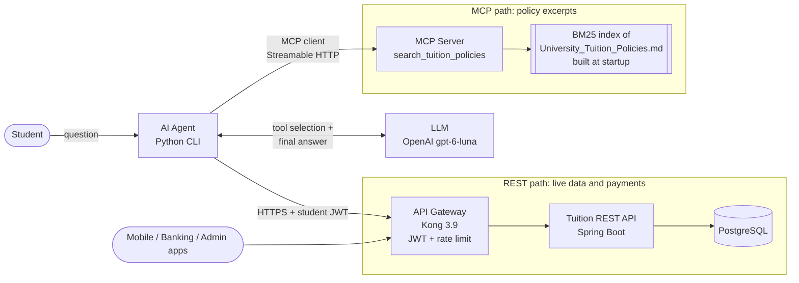

How a turn works:

1. The user asks a question in the agent CLI.
2. The agent sends the question and three tool definitions to the LLM. The LLM chooses which tools to call (real function calling, no keyword routing).
3. **The agent** runs the chosen calls. The LLM never calls a backend itself.
   - `search_tuition_policies` goes to the MCP server. This path does **not** go through the gateway.
   - `get_my_tuition` and the confirmed payment go to the REST API **through Kong**, with the logged-in student's JWT.
4. The tool results go back to the LLM, which writes a grounded answer and cites policy section numbers (for example `Policy §2.1`).
5. The agent prints a **tool trace** for every turn: tool name, input, result and final answer.

Every REST call goes through Kong, including the agent's calls. The API has no public port: locally it has no host port mapping, and in Azure its ingress is internal only.

| | Local (docker compose) | Azure |
|---|---|---|
| Gateway (Kong) | `http://localhost:8090` | Container App `tuition-kong` (external) |
| Tuition API | internal only (`tuition-api:8081`) | Container App `tuition-api` (internal ingress) |
| MCP server | `http://localhost:8091/mcp` | Container App `tuition-mcp` (external) |
| Database | PostgreSQL 17 container (host port 5433) | Azure Database for PostgreSQL Flexible Server |
| Agent | runs on the user's machine | runs on the user's machine (not deployed) |

---

## 2. Live deployment (Azure)

| What | URL |
|---|---|
| **API Gateway** (base URL for all REST calls) | https://tuition-kong.happymoss-ea707327.polandcentral.azurecontainerapps.io |
| **Swagger UI** (through the gateway) | https://tuition-kong.happymoss-ea707327.polandcentral.azurecontainerapps.io/swagger-ui.html |
| OpenAPI document | https://tuition-kong.happymoss-ea707327.polandcentral.azurecontainerapps.io/v3/api-docs (a copy is in [`docs/openapi.json`](docs/openapi.json)) |
| **MCP server** (Streamable HTTP) | https://tuition-mcp.happymoss-ea707327.polandcentral.azurecontainerapps.io/mcp |

Notes:

- **Cold start.** To keep the cost low, the API and the MCP server scale to zero when idle; only Kong is always on. After about 6 minutes without traffic, the first request takes about **30 s** (API) or **10 s** (MCP) while the container starts. Requests after that take well under a second.
- **The cloud database is not in its seed state.** The demo session in this README made a real payment: student `20230001`, term `2026-FALL`, now has 2500 paid and a 2500 balance (seed: 2000 paid). Other testers may change the data further. A local run (section 3) always starts from the seed data.
- The mobile query limit (3 per student per day) is shared by everyone who calls the cloud gateway. If a student number already returns 429, try another one or wait for the next UTC day.

---

## 3. Run locally

### Prerequisites

- Docker with Docker Compose (Docker Desktop, or Colima on macOS)
- To run the unit tests on the host: Java 21 and [uv](https://docs.astral.sh/uv/) (uv installs Python 3.12 for you)
- For the agent: uv and your own OpenAI API key

### Start the backend (PostgreSQL, Tuition API, Kong, MCP server)

```bash
git clone https://github.com/FurkanGncr/se4458-ai-tuition-assistant.git
cd se4458-ai-tuition-assistant

cp .env.example .env
# Edit .env:
#   DB_PASSWORD=<any password>
#   JWT_SECRET=<output of: openssl rand -base64 48>
#   OPENAI_API_KEY=<your key>   (only needed for the agent)

docker compose up -d --build --wait
```

`--wait` returns when all four containers are healthy. Flyway creates the schema and loads the demo data on the first start.

| Service | Container | Host URL / port | Notes |
|---|---|---|---|
| API Gateway | `tuition-kong` | http://localhost:8090 | the only REST entry point |
| Swagger UI | (via Kong) | http://localhost:8090/swagger-ui.html | |
| Tuition API | `tuition-api` | none | reached only through Kong |
| MCP server | `tuition-mcp` | http://localhost:8091/mcp | not behind Kong |
| PostgreSQL | `tuition-postgres` | localhost:5433 | db `tuition` |

Host ports can be changed in `.env` (`KONG_PROXY_PORT`, `MCP_PORT`, `DB_PORT`). Stop everything with `docker compose down`; add `-v` to also delete the database volume and start again from the seed data.

### Run the agent

```bash
cd agent
uv run tuition-agent
```

Log in with a student account, for example `20230001` / `Student123!` (see [test data](#11-test-data-and-reproduction-steps)). The password prompt shows nothing while you type; this is expected. Type `exit` to quit.

By default the agent uses the local gateway and MCP server. To use the Azure deployment instead, set the two URLs as environment variables (they take priority over `.env`):

```bash
cd agent
AGENT_GATEWAY_URL=https://tuition-kong.happymoss-ea707327.polandcentral.azurecontainerapps.io \
AGENT_MCP_URL=https://tuition-mcp.happymoss-ea707327.polandcentral.azurecontainerapps.io/mcp \
uv run tuition-agent
```

| Agent setting (`.env` or environment) | Default | Meaning |
|---|---|---|
| `OPENAI_API_KEY` | (required) | your OpenAI key; it stays on your machine |
| `OPENAI_MODEL` | `gpt-6-luna` | any Chat Completions model with tool calling |
| `OPENAI_REASONING_EFFORT` | `none` | `gpt-6-luna` needs `none` for function calling; leave empty to not send it |
| `AGENT_GATEWAY_URL` | `http://localhost:8090` | Kong base URL |
| `AGENT_MCP_URL` | `http://localhost:8091/mcp` | MCP endpoint |

### Run the API or the MCP server on the host (optional)

```bash
docker compose up -d postgres
cd tuition-api && ./mvnw spring-boot:run           # http://localhost:8081, reads ../.env
cd mcp-server  && MCP_PORT=8092 uv run policy-mcp  # http://127.0.0.1:8092/mcp
```

---

## 4. REST API

All routes are versioned with a URI prefix: **`/api/v1/...`**. The public base URL is always the gateway.

| Spec operation | Method and route (via Kong) | Auth | Paging |
|---|---|---|---|
| Login (issues the JWT) | `POST /api/v1/auth/login` | none | no |
| Mobile app: Query Tuition | `GET /api/v1/mobile/tuition/{studentNo}?term=` | **none**, max **3 calls per student number per day** | no |
| Banking app: Query Tuition | `GET /api/v1/banking/tuition/{studentNo}?term=` | JWT, role `STUDENT` (own number only) or `BANK` | no |
| Banking app: Pay Tuition | `POST /api/v1/banking/payments` | JWT, role `STUDENT` (own number only) or `BANK` | no |
| Admin: Add Tuition | `POST /api/v1/admin/tuition` | JWT, role `ADMIN` | no |
| Admin: Add Tuition – Batch | `POST /api/v1/admin/tuition/batch` (multipart CSV, field `file`) | JWT, role `ADMIN` | no |
| Admin: Unpaid Tuition Status | `GET /api/v1/admin/tuition/unpaid?term=&page=&pageSize=` | JWT, role `ADMIN` | **yes** |

- **Swagger UI:** http://localhost:8090/swagger-ui.html (local) or the [cloud Swagger UI](https://tuition-kong.happymoss-ea707327.polandcentral.azurecontainerapps.io/swagger-ui.html). Click **Authorize** and paste the `accessToken` from the login response.
- **OpenAPI specification:** [`docs/openapi.json`](docs/openapi.json), exported from the running API through the local gateway (its `servers` entry is the local gateway URL).

### Request and response summary

| Operation | Request | Success response |
|---|---|---|
| Login | `{"username","password"}` | 200 `{accessToken, tokenType:"Bearer", expiresIn, role, studentNo}` |
| Query Tuition (mobile and banking) | `term` optional (`2026-FALL`, `2027-SPRING`) | 200 `{studentNo, fullName, term, terms[{term, amount, paidAmount, balance, currency}], totals[{currency, totalAmount, paidAmount, balance}]}` |
| Pay Tuition | `{"studentNo","term","amount","transactionId"}` | 201 `{status:"SUCCESS", transactionId, studentNo, term, paidAmount, totalPaid, remainingBalance, currency, paidAt}` |
| Add Tuition | `{"studentNo","term","amount","currency"}` | 201 `{status:"CREATED", ...}` for a new record, 200 `{status:"UPDATED", ...}` for an existing one |
| Add Tuition – Batch | CSV file, header `studentNo,term,amount,currency` | 200 `{status, totalRows, successCount, failureCount, errors[{row, reason}]}` |
| Unpaid Tuition Status | `term` (required), `page` (1-based, default 1), `pageSize` (default 20, max 100) | 200 `{term, page, pageSize, totalItems, totalPages, items[{studentNo, fullName, amount, paidAmount, balance, currency}]}` |

**Term or overall balance:** with `term`, the response has that one term in `terms[]`. Without `term`, it has every term (in chronological order) plus the overall `totals[]`. Totals are **per currency**, so amounts in different currencies are never added together.

### Errors (RFC 7807)

Errors from the API use **RFC 7807 Problem Details** (`application/problem+json`). `type` is `urn:tuition:problem:<slug>`. Validation errors add an `errors[]` list:

```json
{
  "type": "urn:tuition:problem:validation-failed",
  "title": "Validation Failed",
  "status": 400,
  "detail": "One or more fields are invalid.",
  "instance": "/api/v1/admin/tuition",
  "errors": [
    {"field": "amount", "message": "must be greater than 0"},
    {"field": "term", "message": "must be YYYY-FALL or YYYY-SPRING, e.g. 2026-FALL"}
  ]
}
```

| Status | When |
|---|---|
| 400 | invalid format or validation error (term format, amount ≤ 0, unknown currency, bad CSV file, missing parameter) |
| 401 | no token, invalid or expired token, wrong username or password |
| 403 | wrong role, or a student token used for another student's number |
| 404 | unknown student, or no tuition record for the given term |
| 409 | conflict: duplicate `transactionId`; new tuition amount below the amount already paid; currency change after payments; concurrent create |
| 422 | business rule violation: payment above the balance; payment on a fully paid term |
| 429 | mobile query limit exceeded (returned by Kong) |

Errors produced by Kong itself (missing/invalid token, rate limit, unknown route) are plain JSON, not RFC 7807. See [section 5](#kongs-own-error-responses).

---

## 5. API Gateway (Kong)

Kong runs in **DB-less mode** with the declarative file [`gateway/kong.yml`](gateway/kong.yml). The Admin API is disabled. The image ([`gateway/Dockerfile`](gateway/Dockerfile)) is `kong:3.9.1` with the config baked in, so the same image runs locally and in Azure. At startup, [`gateway/render-config.sh`](gateway/render-config.sh) fills in the `${JWT_SECRET}` and `${TUITION_API_URL}` placeholders from environment variables, so no secret is stored in the repository.

**Gateway URLs**

- Azure: `https://tuition-kong.happymoss-ea707327.polandcentral.azurecontainerapps.io`
- Local: `http://localhost:8090`

### Route mapping

All routes go to the service `tuition-api` (local upstream `http://tuition-api:8081`, Azure upstream `http://tuition-api`) with `strip_path: false`, so the public path equals the API path.

| Kong route | Methods | Public path | Upstream path | Plugins |
|---|---|---|---|---|
| `auth-login` | POST | `/api/v1/auth/login` | same | none (open) |
| `mobile-tuition` | GET | `/api/v1/mobile/tuition/{studentNo}` (regex `~/api/v1/mobile/tuition/[^/]+$`) | same | `pre-function` + `rate-limiting` (3/day per student) |
| `banking` | GET, POST | `/api/v1/banking/...` | same | `jwt` |
| `admin` | GET, POST | `/api/v1/admin/...` | same | `jwt` |
| `api-docs` | GET | `/swagger-ui.html`, `/swagger-ui/...`, `/v3/api-docs` | same | none (open) |
| (none) | any | any other path | none | Kong returns 404 |

### Authentication at the gateway

The `jwt` plugin checks the token's HS256 signature and its `exp` claim before the request reaches the API. It finds the signing key by the token's `iss` claim (`tuition-api`, consumer `tuition-api-issuer`). The token is read only from the `Authorization: Bearer` header. Kong and the API share the same `JWT_SECRET`. The API validates the token again and also checks the role and ownership (defense in depth, see [section 7](#7-authentication-and-authorization)).

### Mobile limit: 3 queries per student per day

The rule is keyed by **student number, not client IP**:

1. A `pre-function` plugin takes the student number from the request path and writes it into the `X-RateLimit-Student` header. It overwrites any value the client sent, so the header cannot be spoofed.
2. The `rate-limiting` plugin counts with `limit_by: header` on that header, `day: 3`, `policy: local`.

The 4th call for the same student number on the same day gets **429**. Another student number from the same client still works. The day is a **UTC** day (it resets at 00:00 UTC). The counter is kept in Kong's memory, so Kong runs as a single replica.

### Protected route demo (Azure)

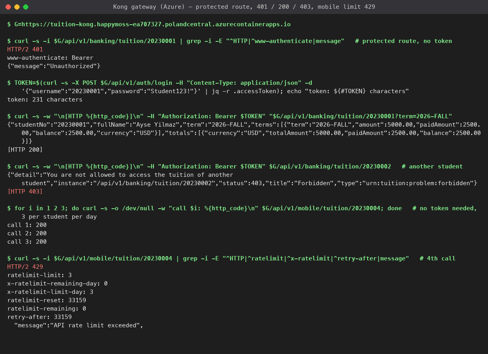

<details>
<summary>Same session as text</summary>

```text
$ G=https://tuition-kong.happymoss-ea707327.polandcentral.azurecontainerapps.io

$ curl -s -i $G/api/v1/banking/tuition/20230001 | grep -i -E "^HTTP|^www-authenticate|message"   # protected route, no token
HTTP/2 401
www-authenticate: Bearer
{"message":"Unauthorized"}

$ TOKEN=$(curl -s -X POST $G/api/v1/auth/login -H "Content-Type: application/json" -d '{"username":"20230001","password":"Student123!"}' | jq -r .accessToken); echo "token: ${#TOKEN} characters"
token: 231 characters

$ curl -s -w "\n[HTTP %{http_code}]\n" -H "Authorization: Bearer $TOKEN" "$G/api/v1/banking/tuition/20230001?term=2026-FALL"
{"studentNo":"20230001","fullName":"Ayse Yilmaz","term":"2026-FALL","terms":[{"term":"2026-FALL","amount":5000.00,"paidAmount":2500.00,"balance":2500.00,"currency":"USD"}],"totals":[{"currency":"USD","totalAmount":5000.00,"paidAmount":2500.00,"balance":2500.00}]}
[HTTP 200]

$ curl -s -w "\n[HTTP %{http_code}]\n" -H "Authorization: Bearer $TOKEN" $G/api/v1/banking/tuition/20230002   # another student
{"detail":"You are not allowed to access the tuition of another student","instance":"/api/v1/banking/tuition/20230002","status":403,"title":"Forbidden","type":"urn:tuition:problem:forbidden"}
[HTTP 403]

$ for i in 1 2 3; do curl -s -o /dev/null -w "call $i: %{http_code}\n" $G/api/v1/mobile/tuition/20230004; done   # no token needed, 3 per student per day
call 1: 200
call 2: 200
call 3: 200

$ curl -s -i $G/api/v1/mobile/tuition/20230004 | grep -i -E "^HTTP|^ratelimit|^x-ratelimit|^retry-after|message"   # 4th call
HTTP/2 429
ratelimit-limit: 3
x-ratelimit-remaining-day: 0
x-ratelimit-limit-day: 3
ratelimit-reset: 33159
ratelimit-remaining: 0
retry-after: 33159
  "message":"API rate limit exceeded",
```

</details>

### Kong's own error responses

| Case | Status | Body |
|---|---|---|
| Protected route without a token | 401 | `{"message":"Unauthorized"}` + header `WWW-Authenticate: Bearer` |
| Token with a bad signature | 401 | `{"message":"Invalid signature"}` |
| Malformed token | 401 | `{"message":"Bad token; invalid JSON"}` |
| Expired token | 401 | `{"exp":"token expired"}` |
| 4th mobile query on the same day | 429 | `{"message":"API rate limit exceeded"}` + headers `RateLimit-Limit`, `RateLimit-Remaining`, `RateLimit-Reset`, `Retry-After`, `X-RateLimit-Limit-Day`, `X-RateLimit-Remaining-Day` |
| Path not in the route table | 404 | `{"message":"no Route matched with those values", "request_id": "..."}` |

Role and ownership errors (403) come from the API as RFC 7807, because Kong does not know about roles.

---

## 6. Data model (ER diagram)

Server database: **PostgreSQL 17** (Azure Database for PostgreSQL Flexible Server in the cloud). The schema is managed by Flyway ([`tuition-api/src/main/resources/db/migration/`](tuition-api/src/main/resources/db/migration/)): `V1` creates the schema, `V2` loads the demo data and `V3` adds the login users. Hibernate only validates the schema (`ddl-auto: validate`).

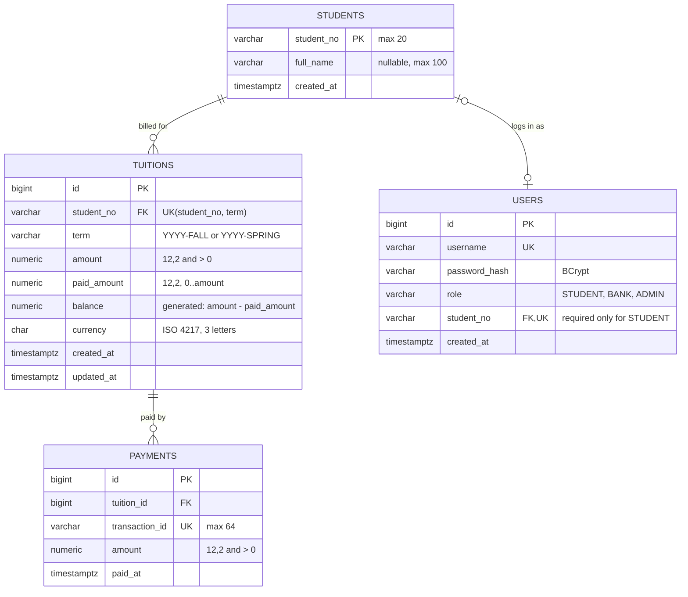

Key constraints:

- `tuitions`: UNIQUE `(student_no, term)`, so there is one record per student and term. `balance` is a generated column. CHECKs: `amount > 0`, `0 ≤ paid_amount ≤ amount`, term format, 3-letter currency. A partial index `(term, student_no) WHERE balance > 0` serves the paged Unpaid Tuition Status query.
- `payments`: UNIQUE `transaction_id` (duplicate payments are rejected even under concurrent requests). Only successful payments are stored. The payment insert and the `paid_amount` update run in one transaction with the tuition row locked (`SELECT ... FOR UPDATE`).
- `users`: CHECK `(role = 'STUDENT') = (student_no IS NOT NULL)`, so every student account is linked to exactly one student and bank/admin accounts are not.

Not stored in the database: the mobile rate-limit counter (Kong), JWTs (stateless) and the policy document (MCP index).

Full table descriptions and design notes: [`docs/er-diagram.md`](docs/er-diagram.md).

---

## 7. Authentication and authorization

- **Login:** `POST /api/v1/auth/login` checks the BCrypt password hash and returns a JWT. An unknown user and a wrong password get the same 401 `invalid-credentials`.
- **Token:** JWT signed with **HS256**, valid for 60 minutes. Claims: `iss=tuition-api`, `sub=<username>`, `role`, `studentNo` (student tokens only), `iat`, `exp`. There is no refresh token; log in again after it expires.
- **Two checks (defense in depth):**
  1. **Kong** verifies the signature and expiry on `/api/v1/banking/**` and `/api/v1/admin/**`.
  2. **Spring Security** (OAuth2 resource server) verifies the token again, then checks the role and the student ownership.
- **Rules:**

| Route | `STUDENT` | `BANK` | `ADMIN` | no token |
|---|---|---|---|---|
| `POST /api/v1/auth/login` | ✓ | ✓ | ✓ | ✓ |
| `GET /api/v1/mobile/tuition/{no}` | ✓ | ✓ | ✓ | ✓ (3 per day) |
| `GET /api/v1/banking/tuition/{no}` | own number only (else 403) | any student | 403 | 401 |
| `POST /api/v1/banking/payments` | own number only (else 403) | any student | 403 | 401 |
| `/api/v1/admin/**` | 403 | 403 | ✓ | 401 |

- The ownership check runs before the business logic, so asking for another student's number always gives **403**, never 404. Nobody can find out whether another student number exists.
- **The agent cannot reach another student's data.** Its tools have no `studentNo` parameter. The student number always comes from the login token. If the LLM sends an extra argument such as `studentNo`, the agent rejects the call. Even a manipulated call would get 403 from the API.

---

## 8. MCP server

[`mcp-server/`](mcp-server/) is a real MCP server built with the **official MCP Python SDK** (`mcp` 2.3.0). It uses the **Streamable HTTP** transport at path `/mcp` (stateless, JSON responses), so it runs as a normal web service. It indexes [`docs/University_Tuition_Policies.md`](docs/University_Tuition_Policies.md) and exposes one tool.

### Tool schema: `search_tuition_policies`

Input schema (as returned by `tools/list`):

```json
{
  "type": "object",
  "properties": {
    "query": {
      "type": "string", "minLength": 1, "maxLength": 500,
      "description": "Natural-language question or keywords, e.g. 'installment eligibility'"
    },
    "top_k": {
      "type": "integer", "minimum": 1, "maximum": 5, "default": 3,
      "description": "Maximum number of sections to return"
    }
  },
  "required": ["query"]
}
```

Output (`structuredContent`, with a matching `outputSchema`; the shape follows policy §9):

```json
{
  "document": "University_Tuition_Policies.md",
  "document_id": "UNI-TUITION-2026-01",
  "query": "payment deadline",
  "matches": [
    {
      "section": "2.2",
      "heading": "Spring term",
      "parent_heading": "Payment deadlines",
      "text": "The payment deadline for the Spring 2027 term is February 15, 2027. ...",
      "score": 4.07
    }
  ]
}
```

- `matches` is sorted by relevance (best first), has at most `top_k` items and contains only sections with a score above 0. A query with no matching words returns `matches: []`.
- An empty query or a `top_k` outside 1–5 returns an MCP tool error (`isError: true`).

### Indexing approach

1. **Chunking** ([`chunking.py`](mcp-server/src/policy_mcp/chunking.py)): the document is split by its Markdown headings. Each `###` subsection is one chunk, and a `##` section without subsections is a chunk of its own. Headings inside code blocks are ignored. Each chunk keeps its **section id** (for example `3.2`), heading, parent heading, document id (`UNI-TUITION-2026-01`) and text. The policy document gives **25 chunks** (§1, §2.1–§8.4, §9).
2. **Text processing:** lower-casing, a small English stop-word list, and Snowball (Porter2) English stemming, so "installments" matches "installment". The indexed text of a chunk is its parent heading + heading + body.
3. **Ranking** ([`bm25.py`](mcp-server/src/policy_mcp/bm25.py)): full-text **BM25** (`k1 = 1.5`, `b = 0.75`). No embeddings or vector search are used.
4. **Indexed once:** the index is built a single time at server startup (`PolicyIndex.from_file`), before the server accepts queries. It is never rebuilt per question; a test checks this.

**No authentication on the MCP server:** it serves only the public policy text and no student data (see [assumptions](#12-assumptions)).

### Three retrieval tests

| # | Query | Top sections | pytest |
|---|---|---|---|
| 1 | `payment deadline` | §2.2 Spring term, §2.1 Fall term, §2.3 Payment posting | `test_query_1_payment_deadline_returns_deadline_sections` |
| 2 | `installments` | §3.2 Number and size of installments, §3.3 Installment schedule, §3.4 Partial payments versus installment approval | `test_query_2_installments_returns_installment_policy` |
| 3 | `refund withdrawal` | §6.1 Early withdrawal, §6.3 Refund processing, §6.2 Later withdrawal | `test_query_3_refund_after_withdrawal_returns_refund_sections` |

The tests are in [`mcp-server/tests/test_retrieval.py`](mcp-server/tests/test_retrieval.py). The same three queries against the **Azure** MCP server, using the official MCP SDK client:

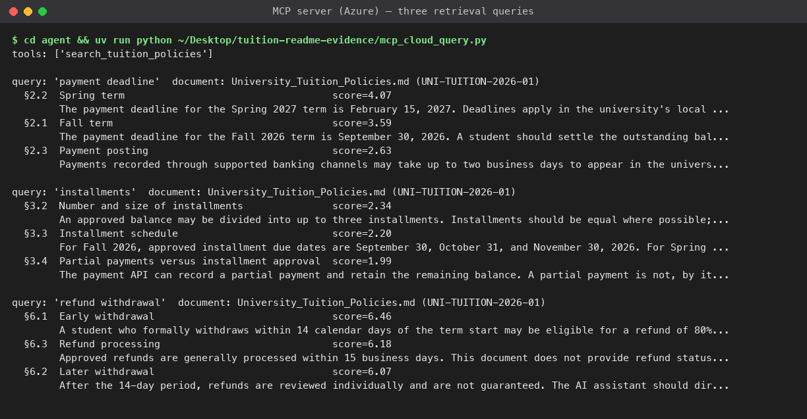

<details>
<summary>Client code and output as text</summary>

```python
# run inside agent/ (it has the mcp package): uv run python mcp_query.py
import anyio
from mcp import Client

URL = "https://tuition-mcp.happymoss-ea707327.polandcentral.azurecontainerapps.io/mcp"

async def main():
    async with Client(URL) as client:
        tools = await client.list_tools()
        print("tools:", [t.name for t in tools.tools])
        for query in ["payment deadline", "installments", "refund withdrawal"]:
            result = await client.call_tool("search_tuition_policies", {"query": query, "top_k": 3})
            data = result.structured_content
            print(f"\nquery: {query!r}  document: {data['document']} ({data['document_id']})")
            for m in data["matches"]:
                print(f"  §{m['section']:<4} {m['heading']:<45} score={m['score']:.2f}")
                print(f"        {m['text'][:110]}...")

anyio.run(main)
```

```text
tools: ['search_tuition_policies']

query: 'payment deadline'  document: University_Tuition_Policies.md (UNI-TUITION-2026-01)
  §2.2  Spring term                                   score=4.07
        The payment deadline for the Spring 2027 term is February 15, 2027. Deadlines apply in the university's local ...
  §2.1  Fall term                                     score=3.59
        The payment deadline for the Fall 2026 term is September 30, 2026. A student should settle the outstanding bal...
  §2.3  Payment posting                               score=2.63
        Payments recorded through supported banking channels may take up to two business days to appear in the univers...

query: 'installments'  document: University_Tuition_Policies.md (UNI-TUITION-2026-01)
  §3.2  Number and size of installments               score=2.34
        An approved balance may be divided into up to three installments. Installments should be equal where possible;...
  §3.3  Installment schedule                          score=2.20
        For Fall 2026, approved installment due dates are September 30, October 31, and November 30, 2026. For Spring ...
  §3.4  Partial payments versus installment approval  score=1.99
        The payment API can record a partial payment and retain the remaining balance. A partial payment is not, by it...

query: 'refund withdrawal'  document: University_Tuition_Policies.md (UNI-TUITION-2026-01)
  §6.1  Early withdrawal                              score=6.46
        A student who formally withdraws within 14 calendar days of the term start may be eligible for a refund of 80%...
  §6.3  Refund processing                             score=6.18
        Approved refunds are generally processed within 15 business days. This document does not provide refund status...
  §6.2  Later withdrawal                              score=6.07
        After the 14-day period, refunds are reviewed individually and are not guaranteed. The AI assistant should dir...
```

</details>

You can also try the server with the **MCP Inspector**:

```bash
npx @modelcontextprotocol/inspector
# Transport: Streamable HTTP, URL: http://localhost:8091/mcp (or the Azure MCP URL)
# Tools → search_tuition_policies → query "payment deadline"
```

---

## 9. AI agent

[`agent/`](agent/) is a Python CLI chat. It uses **OpenAI function calling** (Chat Completions API) to let the LLM choose tools, then runs those tools itself.

### Tools given to the LLM

| Tool | Parameters | What the agent does |
|---|---|---|
| `search_tuition_policies` | `query: string` | calls the MCP server (`top_k = 3`) through the MCP client |
| `get_my_tuition` | `term: string \| null` | `GET /api/v1/banking/tuition/{own studentNo}` **through Kong** with the student's JWT |
| `request_tuition_payment` | `term: string`, `amount: number` | **prepares** a payment only; it does not pay (see below) |

- Schemas are `strict` with `additionalProperties: false`. **No tool has a `studentNo` parameter.** The student number always comes from the login session.
- Only `STUDENT` accounts can log in to the agent. `BANK` and `ADMIN` accounts are refused.
- If the token expires during the chat (401), the agent asks for a new login and clears the history and any pending payment.
- API and MCP errors are returned to the LLM as `{"error": ...}`, so it can explain them. The agent allows at most 5 tool rounds per turn and keeps the last 6 turns as history.

### Payment confirmation is enforced in code

The LLM has **no tool that pays**. A payment takes two steps:

1. **Prepare.** The LLM calls `request_tuition_payment(term, amount)`. The agent's code loads the live balance through Kong and checks the request: amount rounded HALF_UP to cents, greater than 0, not above the balance, term not fully paid. Then it stores one pending payment and ends the turn with a **confirmation message written by the code, not by the LLM**: student, term, amount, current balance and balance after the payment (policy §7.3).
2. **Confirm.** Only if the user's **next input** is exactly `yes` or `evet` (case and spaces ignored) does the code call `POST /api/v1/banking/payments`, with a new UUID as `transactionId`. `no`, `hayır`, `cancel` or `iptal` cancels the payment. Any other text also cancels it and is handled as a new question. Text produced by the LLM can never confirm a payment.

The success message is printed only when the API returns `status: SUCCESS` (policy §7.4). An API rejection is shown as an error. In the trace, the confirmed call appears as `pay_tuition (user confirmed)`.

### Tool trace

After every turn the agent prints the tools it called, with their inputs and results (results are shortened to 900 characters), then the answer and the number of LLM calls and tokens:

```text
── tool trace ──────────────────────────────────────────────
  [1] <tool name>
      input : {...}
      result: {...}
── answer ──────────────────────────────────────────────────
<final answer>
   (llm calls: N · tokens in/out: X/Y)
```

### Scenarios (recorded against the Azure deployment)

The five scenarios below come from one real session: student `20230001`, model `gpt-6-luna`, and the cloud gateway and MCP server. The full session is in the collapsible block after the screenshots.

**1. MCP only: "When is the payment deadline?"** The LLM calls only `search_tuition_policies` and cites §2.1.

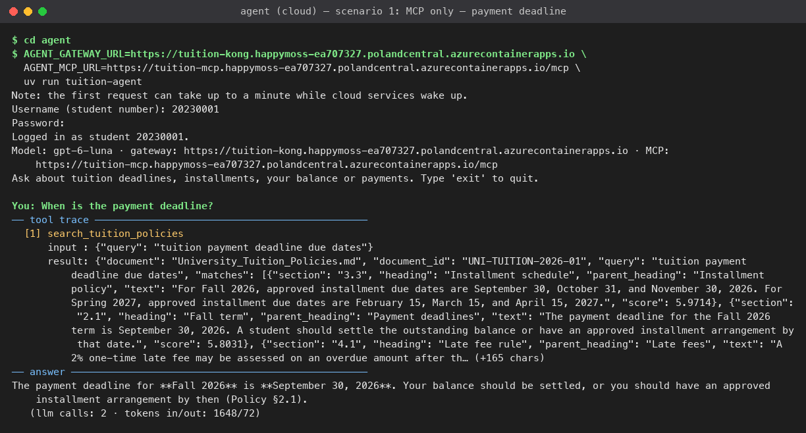

**2. REST API only: "What is my balance?"** The LLM calls only `get_my_tuition` (through Kong).

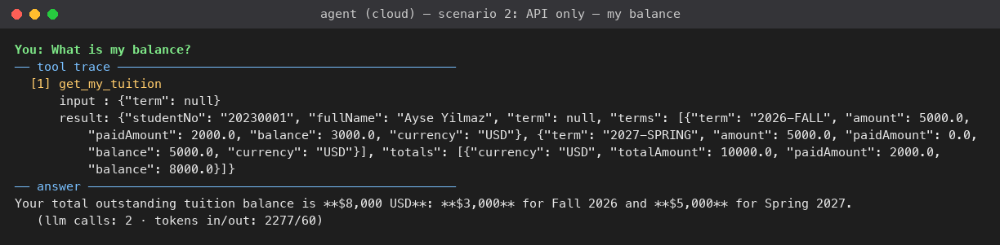

**3. MCP + REST: "Can I pay my outstanding balance in installments?"** The LLM calls both tools. It compares the live balance with the §3.1 eligibility rule and does not promise approval (§3.4).

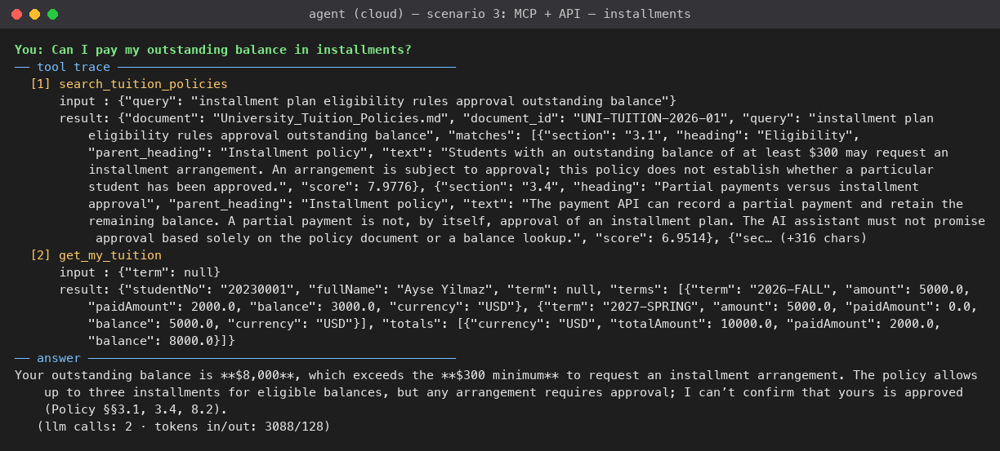

**4. Confirmed simulated payment: "Pay 500 of my 2026-FALL balance" → "evet".** The first turn only prepares the payment and shows the confirmation. After `evet`, the code calls Pay Tuition and reports the API's `SUCCESS` response.

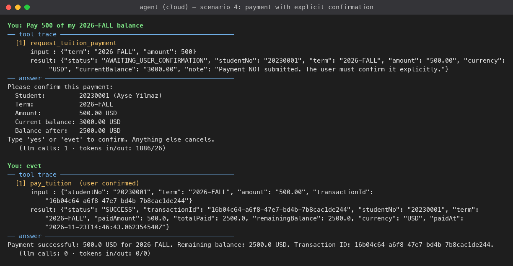

**5. Another student's data: "Show the balance of student 20230002".** Refused, and no tool is called.

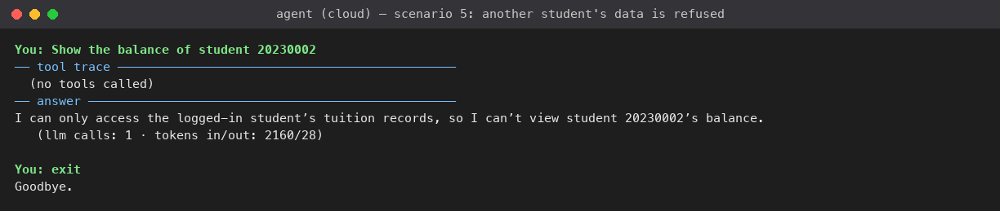

<details>
<summary>Full session transcript (text)</summary>

```text
$ cd agent
$ AGENT_GATEWAY_URL=https://tuition-kong.happymoss-ea707327.polandcentral.azurecontainerapps.io \
  AGENT_MCP_URL=https://tuition-mcp.happymoss-ea707327.polandcentral.azurecontainerapps.io/mcp \
  uv run tuition-agent
Note: the first request can take up to a minute while cloud services wake up.
Username (student number): 20230001
Password:
Logged in as student 20230001.
Model: gpt-6-luna · gateway: https://tuition-kong.happymoss-ea707327.polandcentral.azurecontainerapps.io · MCP: https://tuition-mcp.happymoss-ea707327.polandcentral.azurecontainerapps.io/mcp
Ask about tuition deadlines, installments, your balance or payments. Type 'exit' to quit.

You: When is the payment deadline?
── tool trace ──────────────────────────────────────────────
  [1] search_tuition_policies
      input : {"query": "tuition payment deadline due dates"}
      result: {"document": "University_Tuition_Policies.md", "document_id": "UNI-TUITION-2026-01", "query": "tuition payment deadline due dates", "matches": [{"section": "3.3", "heading": "Installment schedule", "parent_heading": "Installment policy", "text": "For Fall 2026, approved installment due dates are September 30, October 31, and November 30, 2026. For Spring 2027, approved installment due dates are February 15, March 15, and April 15, 2027.", "score": 5.9714}, {"section": "2.1", "heading": "Fall term", "parent_heading": "Payment deadlines", "text": "The payment deadline for the Fall 2026 term is September 30, 2026. A student should settle the outstanding balance or have an approved installment arrangement by that date.", "score": 5.8031}, {"section": "4.1", "heading": "Late fee rule", "parent_heading": "Late fees", "text": "A 2% one-time late fee may be assessed on an overdue amount after th… (+165 chars)
── answer ──────────────────────────────────────────────────
The payment deadline for **Fall 2026** is **September 30, 2026**. Your balance should be settled, or you should have an approved installment arrangement by then (Policy §2.1).
   (llm calls: 2 · tokens in/out: 1648/72)

You: What is my balance?
── tool trace ──────────────────────────────────────────────
  [1] get_my_tuition
      input : {"term": null}
      result: {"studentNo": "20230001", "fullName": "Ayse Yilmaz", "term": null, "terms": [{"term": "2026-FALL", "amount": 5000.0, "paidAmount": 2000.0, "balance": 3000.0, "currency": "USD"}, {"term": "2027-SPRING", "amount": 5000.0, "paidAmount": 0.0, "balance": 5000.0, "currency": "USD"}], "totals": [{"currency": "USD", "totalAmount": 10000.0, "paidAmount": 2000.0, "balance": 8000.0}]}
── answer ──────────────────────────────────────────────────
Your total outstanding tuition balance is **$8,000 USD**: **$3,000** for Fall 2026 and **$5,000** for Spring 2027.
   (llm calls: 2 · tokens in/out: 2277/60)

You: Can I pay my outstanding balance in installments?
── tool trace ──────────────────────────────────────────────
  [1] search_tuition_policies
      input : {"query": "installment plan eligibility rules approval outstanding balance"}
      result: {"document": "University_Tuition_Policies.md", "document_id": "UNI-TUITION-2026-01", "query": "installment plan eligibility rules approval outstanding balance", "matches": [{"section": "3.1", "heading": "Eligibility", "parent_heading": "Installment policy", "text": "Students with an outstanding balance of at least $300 may request an installment arrangement. An arrangement is subject to approval; this policy does not establish whether a particular student has been approved.", "score": 7.9776}, {"section": "3.4", "heading": "Partial payments versus installment approval", "parent_heading": "Installment policy", "text": "The payment API can record a partial payment and retain the remaining balance. A partial payment is not, by itself, approval of an installment plan. The AI assistant must not promise approval based solely on the policy document or a balance lookup.", "score": 6.9514}, {"sec… (+316 chars)
  [2] get_my_tuition
      input : {"term": null}
      result: {"studentNo": "20230001", "fullName": "Ayse Yilmaz", "term": null, "terms": [{"term": "2026-FALL", "amount": 5000.0, "paidAmount": 2000.0, "balance": 3000.0, "currency": "USD"}, {"term": "2027-SPRING", "amount": 5000.0, "paidAmount": 0.0, "balance": 5000.0, "currency": "USD"}], "totals": [{"currency": "USD", "totalAmount": 10000.0, "paidAmount": 2000.0, "balance": 8000.0}]}
── answer ──────────────────────────────────────────────────
Your outstanding balance is **$8,000**, which exceeds the **$300 minimum** to request an installment arrangement. The policy allows up to three installments for eligible balances, but any arrangement requires approval; I can’t confirm that yours is approved (Policy §§3.1, 3.4, 8.2).
   (llm calls: 2 · tokens in/out: 3088/128)

You: Pay 500 of my 2026-FALL balance
── tool trace ──────────────────────────────────────────────
  [1] request_tuition_payment
      input : {"term": "2026-FALL", "amount": 500}
      result: {"status": "AWAITING_USER_CONFIRMATION", "studentNo": "20230001", "term": "2026-FALL", "amount": "500.00", "currency": "USD", "currentBalance": "3000.00", "note": "Payment NOT submitted. The user must confirm it explicitly."}
── answer ──────────────────────────────────────────────────
Please confirm this payment:
  Student:         20230001 (Ayse Yilmaz)
  Term:            2026-FALL
  Amount:          500.00 USD
  Current balance: 3000.00 USD
  Balance after:   2500.00 USD
Type 'yes' or 'evet' to confirm. Anything else cancels.
   (llm calls: 1 · tokens in/out: 1886/26)

You: evet
── tool trace ──────────────────────────────────────────────
  [1] pay_tuition  (user confirmed)
      input : {"studentNo": "20230001", "term": "2026-FALL", "amount": "500.00", "transactionId": "16b04c64-a6f8-47e7-bd4b-7b8cac1de244"}
      result: {"status": "SUCCESS", "transactionId": "16b04c64-a6f8-47e7-bd4b-7b8cac1de244", "studentNo": "20230001", "term": "2026-FALL", "paidAmount": 500.0, "totalPaid": 2500.0, "remainingBalance": 2500.0, "currency": "USD", "paidAt": "2026-11-23T14:46:43.062354540Z"}
── answer ──────────────────────────────────────────────────
Payment successful: 500.0 USD for 2026-FALL. Remaining balance: 2500.0 USD. Transaction ID: 16b04c64-a6f8-47e7-bd4b-7b8cac1de244.
   (llm calls: 0 · tokens in/out: 0/0)

You: Show the balance of student 20230002
── tool trace ──────────────────────────────────────────────
  (no tools called)
── answer ──────────────────────────────────────────────────
I can only access the logged-in student’s tuition records, so I can’t view student 20230002’s balance.
   (llm calls: 1 · tokens in/out: 2160/28)

You: exit
Goodbye.
```

</details>

---

## 10. Tests

All tests run **offline**: no cloud, no live LLM, no running database and no network. Run them from the repository root:

```bash
# Tuition REST API: JUnit + Mockito + Spring MockMvc (needs Java 21)
cd tuition-api && ./mvnw test

# MCP server: pytest
cd mcp-server && uv run pytest

# AI agent: pytest with a fake LLM, a fake REST backend and an in-process MCP server
cd agent && uv run pytest
```

| Suite | Tests | Result | What is covered |
|---|---|---|---|
| `tuition-api` | 91 | ✅ 0 failures | controller tests with real security filters (`@WebMvcTest` + real signed test tokens), service tests with Mockito, CSV parser, JWT service, ownership policy, seed-user hashes |
| `mcp-server` | 20 | ✅ all passed | chunking, the 3 retrieval queries, BM25 edge cases, index built once, the tool over the real MCP protocol (in-memory client) |
| `agent` | 64 | ✅ all passed | MCP-only / REST-only / combined tool selection with a scripted fake LLM, payment confirmation gate, identity (no `studentNo` from the LLM), error handling, REST and MCP clients |

### Success and failure tests per REST operation

Every REST operation has at least one success test and one failure or edge-case test. Examples (controller tests in `tuition-api/src/test/java/edu/se4458/tuition/web/`; service tests in `.../service/` check the business rules):

| Operation | Success test | Failure / edge-case tests |
|---|---|---|
| Login | `AuthControllerTest.login_returns200_withToken_withoutAuthorizationHeader` | `login_returns401_whenCredentialsWrong`, `login_returns400_whenFieldsBlank` |
| Mobile: Query Tuition | `MobileTuitionControllerTest.returnsAllTermsAndTotals_whenNoTermGiven`, `returnsOneTerm_whenTermGiven` | `returns404ProblemDetail_whenStudentUnknown`, `returns400_whenTermFormatInvalid`, `returns400_whenStudentNoHasInvalidCharacters` |
| Banking: Query Tuition | `BankingTuitionControllerTest.returnsTuition_forTerm`, `returns200_whenStudentQueriesOwnNumber` | `returns404_whenNoTuitionForTerm`, `returns400_whenTermIsLowercase`, `returns403_whenStudentQueriesAnotherStudent`, `returns401_whenNoToken`, `returns401_whenTokenExpired`, `returns401_whenTokenSignedWithAnotherKey`, `returns403_forAdminToken` |
| Banking: Pay Tuition | `BankingPaymentControllerTest.returns201_withRemainingBalance`, `returns201_whenBankPaysForAnyStudent` | `returns409_whenTransactionIdDuplicate`, `returns422_whenAmountExceedsBalance`, `returns400_whenAmountNotPositiveAndTransactionIdMissing`, `returns404_whenNoTuitionRecord`, `returns403_whenStudentPaysForAnotherStudent`, `returns401_whenNoToken` |
| Admin: Add Tuition | `AdminTuitionControllerTest.addTuition_returns201_whenCreated`, `addTuition_returns200_whenUpdated` | `addTuition_returns400_whenCurrencyAndTermInvalid`, `addTuition_returns409_whenAmountBelowPaid`, `addTuition_returns401_whenNoToken`, `addTuition_returns403_forStudentToken` |
| Admin: Add Tuition – Batch | `AdminTuitionControllerTest.batch_returns200_withCountsAndRowErrors` | `batch_returns400_whenFilePartMissing`, `batch_returns400_whenFileEmpty`, `batch_returns401_whenNoToken`, `batch_returns403_forBankToken` |
| Admin: Unpaid Tuition Status | `AdminTuitionControllerTest.unpaid_returnsPage_withDefaultPaging` | `unpaid_returns400_whenTermMissing`, `unpaid_returns400_whenPageSizeTooLarge`, `unpaid_returns401_whenNoToken`, `unpaid_returns403_forStudentAndBankTokens` |

Business rules are also tested at the service level, for example `PaymentServiceTest` (partial and full payment, amount above balance, fully paid term, duplicate ID, HALF_UP rounding), `TuitionAdminServiceTest` (create, upsert, amount below paid, currency change after payments, unknown currency, paging) and `TuitionBatchServiceTest` (per-row errors with line numbers, `COMPLETED` / `FAILED` status).

### Evidence

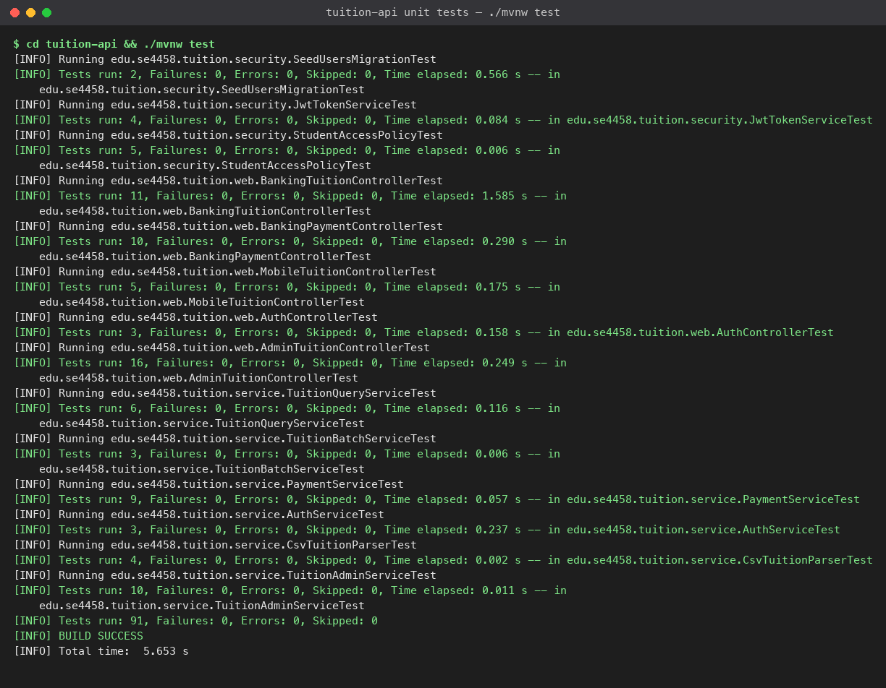

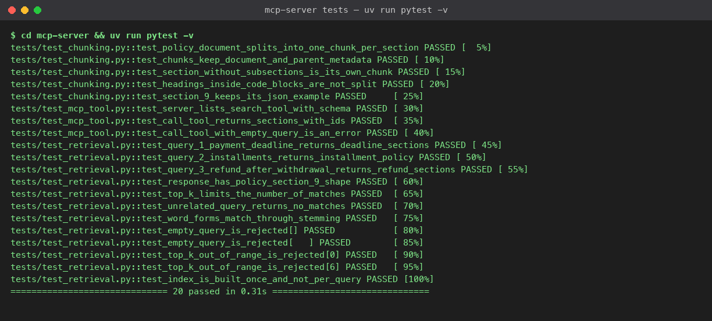

```text
$ cd agent && uv run pytest
tests/test_agent_scenarios.py ........                                   [ 12%]
tests/test_identity.py .........                                         [ 26%]
tests/test_llm_and_config.py ......                                      [ 35%]
tests/test_payment_confirmation.py ...........................           [ 78%]
tests/test_policy_search.py .....                                        [ 85%]
tests/test_tuition_api.py .........                                      [100%]
============================== 64 passed in 0.20s ==============================
```

---

## 11. Test data and reproduction steps

### Demo data (Flyway `V2__seed_demo_data.sql`, all fictitious)

| Student | Name | Term | Amount | Paid | Balance |
|---|---|---|---|---|---|
| `20230001` | Ayse Yilmaz | 2026-FALL | 5000.00 USD | 2000.00 | 3000.00 |
| | | 2027-SPRING | 5000.00 USD | 0.00 | 5000.00 |
| `20230002` | Mehmet Kaya | 2026-FALL | 4500.00 USD | 4500.00 | 0.00 (fully paid) |
| `20230003` | Zeynep Demir | 2026-FALL | 6000.00 USD | 0.00 | 6000.00 |
| `20230004` | Can Ozturk | 2026-FALL | 3000.00 USD | 0.00 | 3000.00 |
| | | 2027-SPRING | 3200.00 EUR | 0.00 | 3200.00 (mixed currency) |

### Login users (Flyway `V3__seed_users.sql`, demo passwords only)

| Username | Password | Role | Student |
|---|---|---|---|
| `20230001` … `20230004` | `Student123!` | `STUDENT` | same as the username |
| `bank` | `Bank123!` | `BANK` | none |
| `admin` | `Admin123!` | `ADMIN` | none |

Passwords are stored as BCrypt hashes. These accounts exist only for the demo and grading.

### Step by step (works locally and on Azure)

Set the gateway URL first. Use the local one after `docker compose up`, or the Azure one. On Azure the first call may take about 30 s (cold start).

```bash
G=http://localhost:8090
# G=https://tuition-kong.happymoss-ea707327.polandcentral.azurecontainerapps.io

login() { curl -s -X POST $G/api/v1/auth/login -H 'Content-Type: application/json' \
          -d "{\"username\":\"$1\",\"password\":\"$2\"}" | jq -r .accessToken; }
ST=$(login 20230003 'Student123!'); BT=$(login bank 'Bank123!'); AT=$(login admin 'Admin123!')
```

**1. Gateway authentication: 401 without a token, 200 for the own number, 403 for another student**

```bash
curl -i $G/api/v1/banking/tuition/20230003                                   # 401 {"message":"Unauthorized"} (Kong)
curl -H "Authorization: Bearer $ST" $G/api/v1/banking/tuition/20230003       # 200, all terms + totals
curl -H "Authorization: Bearer $ST" "$G/api/v1/banking/tuition/20230003?term=2026-FALL"   # 200, one term
curl -H "Authorization: Bearer $ST" $G/api/v1/banking/tuition/20230001       # 403 urn:tuition:problem:forbidden
curl -H "Authorization: Bearer $ST" "$G/api/v1/admin/tuition/unpaid?term=2026-FALL"       # 403 (wrong role)
```

**2. Admin: Add Tuition (create, update, validation error)**

```bash
curl -X POST $G/api/v1/admin/tuition -H "Authorization: Bearer $AT" -H 'Content-Type: application/json' \
     -d '{"studentNo":"20239901","term":"2026-FALL","amount":4000,"currency":"USD"}'
# 201 {"status":"CREATED","studentNo":"20239901","term":"2026-FALL","amount":4000.00,"paidAmount":0.00,"balance":4000.00,"currency":"USD"}

curl -X POST $G/api/v1/admin/tuition -H "Authorization: Bearer $AT" -H 'Content-Type: application/json' \
     -d '{"studentNo":"20239901","term":"2026-FALL","amount":4200,"currency":"USD"}'
# 200 {"status":"UPDATED", ... "amount":4200.00, ... "balance":4200.00}

curl -X POST $G/api/v1/admin/tuition -H "Authorization: Bearer $AT" -H 'Content-Type: application/json' \
     -d '{"studentNo":"20239901","term":"2026-SUMMER","amount":-5,"currency":"USD"}'
# 400 urn:tuition:problem:validation-failed, errors[] for amount and term
```

**3. Admin: Add Tuition – Batch (2 valid rows, 2 invalid rows)**

```bash
cat > batch.csv <<'EOF'
studentNo,term,amount,currency
20239902,2026-FALL,3500,USD
20239903,2027-SPRING,2800.50,EUR
20239904,2026-WINTER,1000,USD
20239905,2026-FALL,abc,USD
EOF
curl -X POST $G/api/v1/admin/tuition/batch -H "Authorization: Bearer $AT" -F "file=@batch.csv;type=text/csv"
# 200 {"status":"COMPLETED_WITH_ERRORS","totalRows":4,"successCount":2,"failureCount":2,
#      "errors":[{"row":4,"reason":"term must be YYYY-FALL or YYYY-SPRING, e.g. 2026-FALL"},
#                {"row":5,"reason":"amount 'abc' is not a valid number"}]}
```

**4. Admin: Unpaid Tuition Status (paged)**

```bash
curl -H "Authorization: Bearer $AT" "$G/api/v1/admin/tuition/unpaid?term=2026-FALL&page=1&pageSize=2"
# 200 {"term":"2026-FALL","page":1,"pageSize":2,"totalItems":...,"totalPages":...,"items":[...]}
```

**5. Banking: Pay Tuition (success, duplicate transaction, amount above balance)**

```bash
TX=$(uuidgen)
curl -X POST $G/api/v1/banking/payments -H "Authorization: Bearer $BT" -H 'Content-Type: application/json' \
     -d "{\"studentNo\":\"20239901\",\"term\":\"2026-FALL\",\"amount\":1000,\"transactionId\":\"$TX\"}"
# 201 {"status":"SUCCESS", ..., "paidAmount":1000.00,"totalPaid":1000.00,"remainingBalance":3200.00,"currency":"USD", ...}

# same transactionId again
curl -X POST $G/api/v1/banking/payments -H "Authorization: Bearer $BT" -H 'Content-Type: application/json' \
     -d "{\"studentNo\":\"20239901\",\"term\":\"2026-FALL\",\"amount\":1000,\"transactionId\":\"$TX\"}"
# 409 urn:tuition:problem:duplicate-transaction

curl -X POST $G/api/v1/banking/payments -H "Authorization: Bearer $BT" -H 'Content-Type: application/json' \
     -d "{\"studentNo\":\"20239901\",\"term\":\"2026-FALL\",\"amount\":99999,\"transactionId\":\"$(uuidgen)\"}"
# 422 urn:tuition:problem:payment-exceeds-balance
#     "Payment amount 99999.00 exceeds the outstanding balance 3200.00 USD"
```

**6. Mobile: Query Tuition, 3 calls per student per day**

```bash
for i in 1 2 3 4; do curl -s -o /dev/null -w "call $i: %{http_code}\n" $G/api/v1/mobile/tuition/20239901; done
# call 1: 200 / call 2: 200 / call 3: 200 / call 4: 429
curl -s -o /dev/null -w "%{http_code}\n" $G/api/v1/mobile/tuition/20239902    # 200: another student still works
```

**7. Agent scenarios.** Run the agent (section 3), log in as `20230001` / `Student123!` and ask:

1. `When is the payment deadline?` → MCP only
2. `What is my balance?` → REST only
3. `Can I pay my outstanding balance in installments?` → MCP + REST
4. `Pay 500 of my 2026-FALL balance`, then `evet` → confirmed payment
5. `Show the balance of student 20230002` → refused

**8. MCP retrieval.** Run `cd mcp-server && uv run pytest -v`, or use the MCP Inspector or the client snippet in [section 8](#8-mcp-server).

To return to the seed data locally: `docker compose down -v && docker compose up -d --build --wait`.

---

## 12. Assumptions

### Billing and money

- Amounts are `BigDecimal` / `numeric(12,2)`: **2 decimal places, HALF_UP rounding**. Inputs are rounded first, then they must still be greater than 0 (so `0.004` is rejected).
- Tuition is stored **per term**. Query Tuition with `term` returns that term. Without `term`, it returns every term and the overall balance. Overall totals are grouped **by currency**, so USD and EUR are never added together. There is no currency conversion.
- A term is `YYYY-FALL` or `YYYY-SPRING` (for example `2026-FALL`). There is no summer term.
- Currencies must be real ISO 4217 codes (checked with `java.util.Currency`).
- `balance = amount − paid amount`. It is a generated database column and is never written directly.

### Add Tuition and Batch (duplicate handling)

- There is one record per `(studentNo, term)`. Adding tuition for an existing pair **updates** the amount (upsert): 201 `CREATED` for a new record, 200 `UPDATED` for an existing one.
- A new amount below the amount already paid is rejected with **409**. The currency can change only while nothing has been paid for that term (otherwise 409).
- There is no "create student" endpoint. Add Tuition and Batch create an unknown student number automatically, without a name.
- **Batch:** the CSV header `studentNo,term,amount,currency` is required (case-insensitive) and the file may be at most 1 MB. Each row is processed in its own transaction, so invalid rows do not stop the batch. `row` in the error list is the line number in the file (the header is line 1), and blank lines are skipped. If the same `(studentNo, term)` appears twice, the later row updates the earlier one. The status is `COMPLETED`, `COMPLETED_WITH_ERRORS` or `FAILED`.

### Payments

- Payments are **simulated**. There is no real money and no card processing.
- The amount must be greater than 0 and **not above the term's balance**; overpayment is rejected (422). A payment on a fully paid term is also 422. A repeated `transactionId` is rejected with **409**, even under concurrent requests (unique constraint).
- A payment is in the currency of the tuition record.
- Payments post **immediately**. The "up to two business days" posting delay in policy §2.3 is not simulated.
- Only successful payments are stored. "Payment status" in the response is produced by the API.

### Policy interpretation (agent)

- There are no APIs for installment plans, late fees or scholarships. The agent only **explains the policy**.
- The agent **never says an installment plan is approved** (policy §3.4) and **never assumes a scholarship** (policy §5.2). A partial payment is not an installment approval.
- Answers based on MCP results cite the policy section numbers.

### API errors

- API errors use RFC 7807 with English messages (the API locale is fixed to `en`). Status codes are listed in [section 4](#errors-rfc-7807).
- Kong's own errors (401, 429, 404) use Kong's JSON format, listed in [section 5](#kongs-own-error-responses).
- An invalid token sent to the **open** mobile route gets 401 from the API, because Spring Security checks every Bearer header it receives. Clients should not send a token to that route; the agent never does.

### Identity and security

- Authentication uses JWT (HS256) issued by the API's own login endpoint. This is a documented equivalent of OAuth 2.0 bearer tokens. There is no refresh token and no logout; tokens expire after 60 minutes.
- `STUDENT` tokens can read and pay only their own student number. `BANK` can query and pay for any student (it is the banking app). `ADMIN` can use only the admin routes (403 on banking routes).
- The **mobile rate limit is per student number, not per client IP**, as the assignment requires. Its day is a **UTC** day. The counter lives in Kong's memory: it resets when Kong restarts, and Kong runs as one replica.
- The **AI agent** accepts only `STUDENT` logins and takes the student number from the token. A student number typed in a prompt is never used.
- **The MCP server has no authentication.** It serves only the public policy document, with no student data. With `MCP_HOST=0.0.0.0` (in the container) the SDK's Host-header (DNS rebinding) check is turned off; this is acceptable because the server holds only public text.
- The seeded passwords are for demo and grading only.

### Deployment

- The API, the MCP server, Kong and PostgreSQL run on **Azure** (section 14). The **agent is not deployed**: it is a CLI that runs on the user's machine with the user's own OpenAI key, so the key never reaches the cloud.
- The database allows public access only from Azure services (no VNet, to keep the setup simple and within the student budget). TLS is required (`sslmode=require`).
- To save cost, the API and the MCP server **scale to zero** when idle, and the first request after a pause waits for a cold start (about 30 s for the API). Kong's upstream read timeout is 120 s and the agent's HTTP timeout is 130 s to cover this.
- Docker images are built for `linux/amd64` (the development machine is Apple Silicon).

---

## 13. LLM cost

- **Model:** `gpt-6-luna` (Chat Completions API), chosen as the cheapest current OpenAI model with tool calling: **$0.10 per 1M input tokens and $0.50 per 1M output tokens**. The model is set by `OPENAI_MODEL`, so any other tool-calling model can be used.
- **Measured:** the recorded 6-turn session (section 9) used **10,869 input tokens and 338 output tokens** in total, about **$0.0013**, or roughly **$0.0002 per turn**. A turn with tools uses 2 LLM calls (tool selection, then the answer). The payment confirmation step uses no LLM call.
- **Keeping it small:** short system prompt, 3 compact tool schemas, history limited to the last 6 turns, tool results shortened, at most 5 tool rounds per turn.
- **Testing costs nothing:** all agent tests use a scripted fake LLM behind the same interface as the OpenAI client. No API key or network is needed (`uv run pytest`).
- The agent runs locally with the user's own `OPENAI_API_KEY`. No LLM key is stored in the cloud or in the repository.

---

## 14. Cloud deployment steps

### Azure resources (Azure for Students)

| Resource | Name | Settings |
|---|---|---|
| Resource group | `rg-tuition-assistant` | |
| Container Registry | `<acr-name>` | **Standard** tier, admin user on (the apps pull with it), Germany West Central |
| PostgreSQL Flexible Server | `<pg-server>` | **Burstable B1ms**, 32 GB, PostgreSQL 17, auto-grow off, HA off, geo-backup off, 7-day backups, public access only for Azure services, `require_secure_transport=on`, **Poland Central**; database `tuition` |
| Container Apps environment | `tuition-env` | **WorkloadProfiles** mode (Consumption profile), Log Analytics, Poland Central |
| Container App `tuition-api` | | **internal** ingress, port 8081, 0.5 vCPU / 1 GiB, min 0 / max 1 replicas |
| Container App `tuition-mcp` | | **external** ingress, port 8000, 0.25 vCPU / 0.5 GiB, min 0 / max 1 |
| Container App `tuition-kong` | | **external** ingress, port 8000, 0.25 vCPU / 0.5 GiB, **min 1 / max 1** (always on; one replica because the rate-limit counter is in memory) |

Cost: only Kong runs all the time, about **$4–5 per month**. The API and the MCP server scale to zero when idle. A $10/month budget with e-mail alerts watches the subscription.

### Steps

Prerequisites: Azure CLI with the `containerapp` extension (`az extension add --name containerapp --upgrade`), `az login`, and Docker with `buildx`. Replace the placeholders, and keep the real values in a gitignored file, never in the repository.

```bash
RG=rg-tuition-assistant
LOCATION=polandcentral          # Container Apps + PostgreSQL
ACR=<acr-name>                  # globally unique
PG=<pg-server>                  # globally unique
PG_ADMIN=<pg-admin-user>
PG_PASSWORD=<strong-password>
JWT_SECRET=$(openssl rand -base64 48)
ENV=tuition-env

# 0. Register the resource providers (once per subscription)
for p in Microsoft.App Microsoft.OperationalInsights Microsoft.ContainerRegistry Microsoft.DBforPostgreSQL; do
  az provider register -n $p --wait
done

# 1. Resource group and container registry
az group create -n $RG -l $LOCATION
az acr create -g $RG -n $ACR -l germanywestcentral --sku Standard --admin-enabled true

# 2. Build the images for linux/amd64 and push them
az acr login -n $ACR
docker buildx build --platform linux/amd64 -t $ACR.azurecr.io/tuition-api:v1  --push ./tuition-api
docker buildx build --platform linux/amd64 -t $ACR.azurecr.io/tuition-kong:v2 --push ./gateway
docker buildx build --platform linux/amd64 --build-context policy=./docs \
                    -t $ACR.azurecr.io/tuition-mcp:v1 --push ./mcp-server

# 3. PostgreSQL Flexible Server (public access for Azure services only: 0.0.0.0)
az postgres flexible-server create -g $RG -n $PG -l $LOCATION \
  --tier Burstable --sku-name Standard_B1ms --storage-size 32 --storage-auto-grow Disabled \
  --version 17 --admin-user $PG_ADMIN --admin-password "$PG_PASSWORD" \
  --backup-retention 7 --geo-redundant-backup Disabled \
  --public-access 0.0.0.0 --database-name tuition --yes
PG_FQDN=$(az postgres flexible-server show -g $RG -n $PG --query fullyQualifiedDomainName -o tsv)

# 4. Container Apps environment. WorkloadProfiles mode is required: the default
#    "Express" mode has no internal service discovery, so Kong could not reach the API by name.
az containerapp env create -g $RG -n $ENV -l $LOCATION \
  --environment-mode WorkloadProfiles --logs-destination log-analytics

# 5. Tuition API (internal only). Flyway creates the schema and the demo data on the first start.
az containerapp create -g $RG -n tuition-api --environment $ENV \
  --image $ACR.azurecr.io/tuition-api:v1 --registry-server $ACR.azurecr.io \
  --ingress internal --target-port 8081 --transport http --allow-insecure \
  --cpu 0.5 --memory 1.0Gi --min-replicas 0 --max-replicas 1 \
  --secrets "db-password=$PG_PASSWORD" "jwt-secret=$JWT_SECRET" \
  --env-vars "SPRING_DATASOURCE_URL=jdbc:postgresql://$PG_FQDN:5432/tuition?sslmode=require" \
             "DB_USERNAME=$PG_ADMIN" "DB_PASSWORD=secretref:db-password" "JWT_SECRET=secretref:jwt-secret"

# 6. MCP server (public)
az containerapp create -g $RG -n tuition-mcp --environment $ENV \
  --image $ACR.azurecr.io/tuition-mcp:v1 --registry-server $ACR.azurecr.io \
  --ingress external --target-port 8000 --transport http \
  --cpu 0.25 --memory 0.5Gi --min-replicas 0 --max-replicas 1

# 7. Kong gateway (public, always on, one replica). Same JWT secret as the API.
az containerapp create -g $RG -n tuition-kong --environment $ENV \
  --image $ACR.azurecr.io/tuition-kong:v2 --registry-server $ACR.azurecr.io \
  --ingress external --target-port 8000 --transport http \
  --cpu 0.25 --memory 0.5Gi --min-replicas 1 --max-replicas 1 \
  --secrets "jwt-secret=$JWT_SECRET" \
  --env-vars "JWT_SECRET=secretref:jwt-secret" "TUITION_API_URL=http://tuition-api" \
             "KONG_DATABASE=off" "KONG_PROXY_LISTEN=0.0.0.0:8000" "KONG_ADMIN_LISTEN=off" \
             "KONG_PORT_MAPS=443:8000" "KONG_TRUSTED_IPS=0.0.0.0/0,::/0" "KONG_NGINX_WORKER_PROCESSES=1" \
             "KONG_PROXY_ACCESS_LOG=/dev/stdout" "KONG_PROXY_ERROR_LOG=/dev/stderr"

# 8. Public URLs
az containerapp show -g $RG -n tuition-kong --query properties.configuration.ingress.fqdn -o tsv
az containerapp show -g $RG -n tuition-mcp  --query properties.configuration.ingress.fqdn -o tsv
```

Notes:

- `TUITION_API_URL=http://tuition-api` is the API's internal address inside the environment (internal ingress on port 80, so `--allow-insecure` is needed for plain HTTP).
- `KONG_PORT_MAPS=443:8000` and `KONG_TRUSTED_IPS` make Kong pass the original `https` scheme and port to the API, so the server URL in Swagger UI is the public `https` gateway URL.
- **Update an app:** build and push a new tag, then `az containerapp update -g $RG -n <app> --image $ACR.azurecr.io/<image>:<new-tag>`.
- **Remove everything:** `az group delete -n $RG` (this cannot be undone).

### Verify the deployment

```bash
G=https://$(az containerapp show -g $RG -n tuition-kong --query properties.configuration.ingress.fqdn -o tsv)
curl -i $G/api/v1/banking/tuition/20230001                    # 401 from Kong
curl -s -X POST $G/api/v1/auth/login -H 'Content-Type: application/json' \
     -d '{"username":"20230001","password":"Student123!"}'   # 200 with accessToken (first call: ~30 s cold start)
```

Then follow [section 11](#11-test-data-and-reproduction-steps) with this `G`.

---

## 15. Repository layout

```
.
├── README.md
├── docker-compose.yml            # local stack: postgres, tuition-api, kong, mcp-server
├── .env.example                  # copy to .env (gitignored)
├── docs/
│   ├── University_Tuition_Policies.md   # the policy document indexed by the MCP server
│   ├── er-diagram.md             # ER diagram and constraints
│   ├── openapi.json              # exported OpenAPI 3 specification
│   └── images/evidence/          # screenshots used in this README
├── tuition-api/                  # Spring Boot REST API (Java 21, Maven wrapper)
│   ├── src/main/java/edu/se4458/tuition/   # config, domain, dto, error, repository, security, service, web
│   ├── src/main/resources/db/migration/    # Flyway V1 schema, V2 demo data, V3 users
│   └── src/test/java/...                    # JUnit + Mockito + MockMvc tests
├── gateway/                      # Kong: kong.yml, render-config.sh, Dockerfile
├── mcp-server/                   # MCP server (package policy_mcp) + pytest
└── agent/                        # CLI agent (package tuition_agent) + pytest
```
