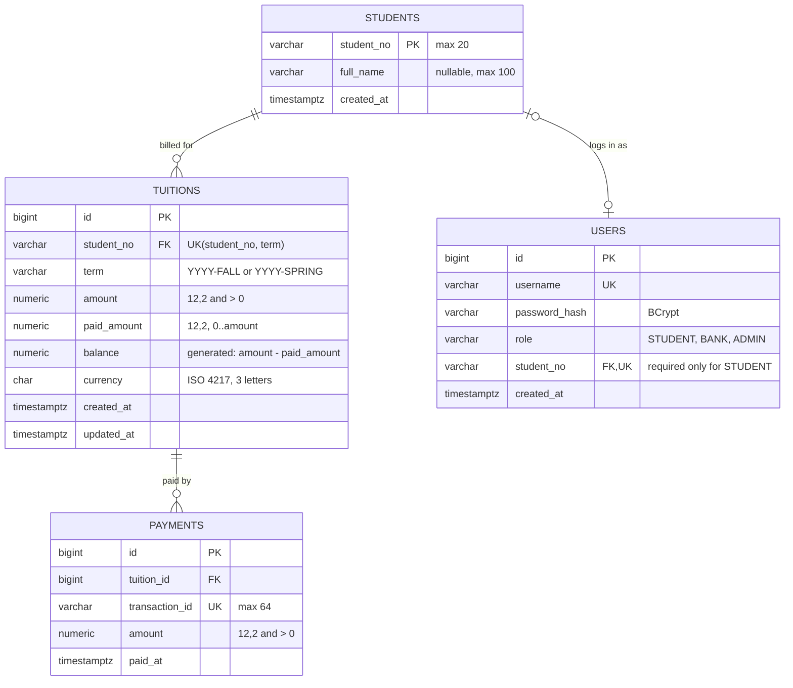

# Tuition API — ER / Data Model

Database: **PostgreSQL**. The schema is created by the Flyway migrations in `tuition-api/src/main/resources/db/migration/` (`V1` schema, `V2` demo data, `V3` login users).

## Tables

| Table | Purpose | Used by |
|---|---|---|
| `students` | Student registry (student number + optional name). | All operations (keyed by Student No); Unpaid Tuition Status lists students. |
| `tuitions` | One tuition record per student per term: total, paid amount, balance, currency. | Query Tuition (mobile + banking), Add Tuition, Add Tuition – Batch, Unpaid Tuition Status. |
| `payments` | Every successful simulated payment. | Pay Tuition. |
| `users` | Login accounts for JWT authentication, with a role and (for students) the owned student number. | Login, authorization and ownership checks. |

## Relationships

- `students` 1 — 0..N `tuitions`: a student can have tuition for several terms.
- `tuitions` 1 — 0..N `payments`: a term's tuition can be paid in several partial payments.
- `students` 1 — 0..1 `users`: a student has at most one login account. `BANK` and `ADMIN` users are not linked to a student.

## Constraints and rules

| Table | Constraint | Rule it enforces |
|---|---|---|
| `students` | PK `student_no` | One record per student number. |
| `tuitions` | UNIQUE `(student_no, term)` | One tuition record per student and term. A repeated Add Tuition **updates** the existing record (upsert) instead of creating a duplicate. |
| `tuitions` | CHECK `term ~ '^[0-9]{4}-(FALL\|SPRING)$'` | Term format, e.g. `2026-FALL`, `2027-SPRING`. |
| `tuitions` | CHECK `amount > 0` | Tuition total must be positive. |
| `tuitions` | CHECK `paid_amount >= 0 AND paid_amount <= amount` | No overpayment. An update that lowers `amount` below `paid_amount` is rejected (the API returns 409 before reaching the database). |
| `tuitions` | `balance` GENERATED ALWAYS AS `(amount - paid_amount)` STORED | Balance is always derived, never written by hand. |
| `tuitions` | CHECK `currency ~ '^[A-Z]{3}$'` | ISO 4217 currency code, e.g. `USD`. |
| `tuitions` | Partial index `(term, student_no) WHERE balance > 0` | Fast, paged Unpaid Tuition Status queries. |
| `payments` | UNIQUE `transaction_id` | Duplicate transaction IDs are rejected (409), even under concurrent requests (idempotency key, policy §7.4). |
| `payments` | CHECK `amount > 0` | Payment amount must be positive. |
| `payments` | Index `tuition_id` | Fast lookup of payments for a tuition record. |
| `users` | UNIQUE `username` | One account per username. |
| `users` | CHECK `role IN ('STUDENT','BANK','ADMIN')` | Allowed roles. |
| `users` | UNIQUE `student_no` (nullable FK) | At most one login account per student. |
| `users` | CHECK `(role = 'STUDENT') = (student_no IS NOT NULL)` | A `STUDENT` user is linked to exactly one student; `BANK`/`ADMIN` users are not. |

## Design notes

- **Money:** all amounts are `numeric(12,2)`. In Java they are `BigDecimal` with scale 2 and `HALF_UP` rounding.
- **Term vs. overall balance:** balance is stored per term. Query Tuition with `term` returns that term's row. Without `term`, it returns every term plus overall totals (sum of rows).
- **Why `paid_amount` is stored on `tuitions`:** the Unpaid Tuition Status query can page over `balance > 0` without summing payments for every row. Inserting a payment and updating `paid_amount` happen in the **same transaction** with the tuition row locked, so the two stay consistent.
- **Payments hold only successful payments.** Rejected payments (over balance, duplicate ID, invalid amount) are not stored, so there is no status column. The "payment status" in the API response is produced by the API. A payment is always in its tuition record's currency, so `payments` has no currency column.
- **Add Tuition with an unknown student number** creates the student automatically (without a name). Seeded students have names.
- **Currency change on upsert** is allowed only while `paid_amount = 0`. If payments exist, a different currency is rejected with 409.

## Not stored in the database

- **Mobile rate-limit counter** (3 queries per student per day): kept by the Kong gateway.
- **JWT tokens:** stateless. The API verifies the signature and does not store tokens.
- **Tuition policy document:** indexed by the MCP server (BM25), not stored in this database.
- **Installment plans, late fees, scholarships:** the assignment defines no API for them, so they are not modeled. The agent only explains the policy.
